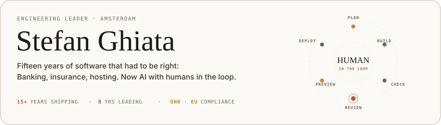
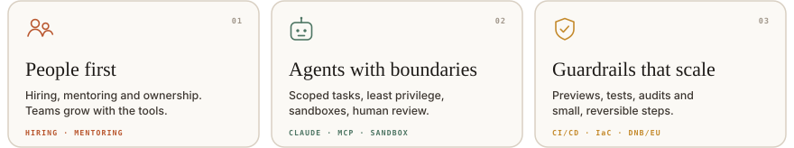
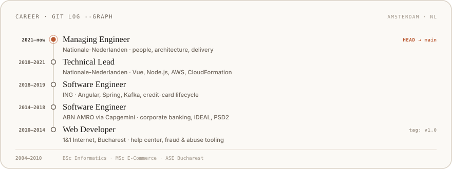

<picture>
  <source media="(prefers-color-scheme: dark)" srcset="assets/hero-night.svg">
  <source media="(prefers-color-scheme: light)" srcset="assets/hero-day.svg">
  
</picture>

  <a href="https://ghiata.com"><picture><source media="(prefers-color-scheme: dark)" srcset="assets/nav-site-night.svg"><source media="(prefers-color-scheme: light)" srcset="assets/nav-site-day.svg"></picture></a>
  <a href="https://github.com/ghiata"><picture><source media="(prefers-color-scheme: dark)" srcset="assets/nav-github-night.svg"><source media="(prefers-color-scheme: light)" srcset="assets/nav-github-day.svg"></picture></a>
  <a href="https://nl.linkedin.com/in/stefan-g-82933784"><picture><source media="(prefers-color-scheme: dark)" srcset="assets/nav-linkedin-night.svg"><source media="(prefers-color-scheme: light)" srcset="assets/nav-linkedin-day.svg"></picture></a>
  <a href="mailto:stefan@ghiata.com"><picture><source media="(prefers-color-scheme: dark)" srcset="assets/nav-email-night.svg"><source media="(prefers-color-scheme: light)" srcset="assets/nav-email-day.svg"></picture></a>

## What I do

  <picture>
    <source media="(max-width: 600px) and (prefers-color-scheme: dark)" srcset="assets/pillars-mobile-night.svg">
    <source media="(max-width: 600px)" srcset="assets/pillars-mobile-day.svg">
    <source media="(prefers-color-scheme: dark)" srcset="assets/pillars-night.svg">
    
  </picture>

## Career

  <picture>
    <source media="(max-width: 600px) and (prefers-color-scheme: dark)" srcset="assets/career-mobile-night.svg">
    <source media="(max-width: 600px)" srcset="assets/career-mobile-day.svg">
    <source media="(prefers-color-scheme: dark)" srcset="assets/career-night.svg">
    
  </picture>

## Toolbox

**Languages & frameworks** — TypeScript · Node.js · Java · Spring · Angular · Vue · Astro  
**Cloud & delivery** — AWS · CloudFormation · Kubernetes · Kafka · GitHub Actions · Cloudflare  
**AI engineering** — Claude Code · MCP · agent sandboxing · local LLMs with llama.cpp, vLLM and Ollama

## Off the clock

Welding, Minecraft mods, a smart mirror, potato batteries with the kids, fishing (catch and release), photography, and travel — mostly Europe, with a soft spot for the Carpathians. More at [ghiata.com](https://ghiata.com).

<em>AI transformation, with a human hand on it.</em>

